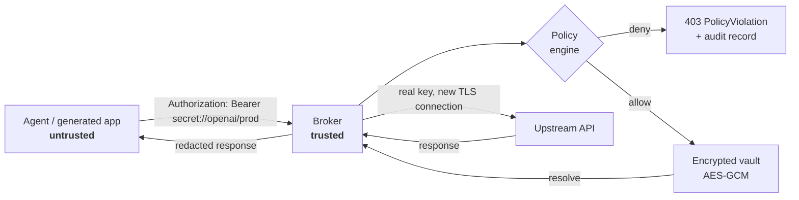
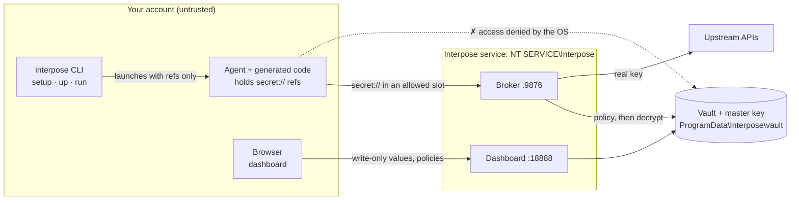

# Interpose

**Credential interposition for untrusted AI agents.**

[](https://github.com/Coelhomicka/interpose/actions/workflows/ci.yml)
[](LICENSE)
[](https://www.python.org/downloads/)
[](#project-status)

Coding agents write `.env` files, run shell commands, and paste config into prompts. Every one of
those is a place a real API key can end up. Interpose removes the key from the agent's reach
entirely: the agent gets an opaque reference, and a trusted local broker performs the authenticated
request on its behalf.

```dotenv
# what the agent sees, writes, and can leak
OPENAI_API_KEY=secret://openai/prod
OPENAI_BASE_URL=http://127.0.0.1:9876/proxy/api.openai.com/v1
```

The agent's HTTP client works unmodified. The plaintext key never enters the agent's process,
environment, arguments, logs, or context window.

The name is the mechanism. *Interposition* is the practice of inserting a trusted layer between a
caller and the resource it is reaching for — so the call still works, and the caller never holds
what makes it work.

---

## How it works



The order matters: **policy is evaluated before the secret is resolved.** A request to a destination
the policy does not allow is denied while the value is still encrypted at rest.

### Where each piece runs



On Windows, `interpose setup` installs the broker and dashboard as a service under its own OS
identity, so the vault is out of reach of anything running as you — including the agent. Without it
(development mode, and on Linux and macOS today) the same components run as you from
`interpose up`. [`docs/en/ARCHITECTURE.md`](docs/en/ARCHITECTURE.md) has the full picture, the install and
login flows, and the request lifecycle.

## Install

```bash
python -m venv .venv
source .venv/bin/activate       # Windows: .\.venv\Scripts\Activate.ps1
python -m pip install -e ".[dev]"
```

Runtime state lives in `~/.interpose` (`%USERPROFILE%\.interpose` on Windows). Keep the
administrative shell, the database, and the master key outside the agent's workspace.

### Protect the vault: install the service (Windows)

Out of the box the broker runs as you, so any program running as you, an agent included, can read
the vault and its key from disk. Install the service once to close that:

```powershell
interpose setup        # one administrator (UAC) prompt; never again after this
```

`setup` copies a private Python runtime and Interpose into `%ProgramFiles%\Interpose`, registers
the `Interpose` service under the virtual account `NT SERVICE\Interpose` (no password, no login),
and moves your vault into `%ProgramData%\Interpose\vault`, which only that account, SYSTEM, and
elevated administrators can open. The copy in your profile is destroyed. From then on
`interpose up` just opens the dashboard of the running service, and `interpose run` points
sessions at it. Nothing else changes for the agent.

Run `setup` yourself, not from an agent session: until the service exists, the code it installs
from is still writable by that agent. Never run an agent elevated; an administrator can read
anything. `interpose service status|start|stop|uninstall` manage the service; `uninstall` keeps the
vault unless you pass `--purge`.

In `session.yaml`, write broker URLs as `${INTERPOSE_PROXY}/<host>`. It expands to the broker
address for the current project, with or without the service.

## Quickstart: the dashboard

From your project folder:

```bash
interpose up
```

```text
  Interpose
  Project:    my-app (C:\code\my-app)
  Proxy:      http://127.0.0.1:9876
  Dashboard:  http://127.0.0.1:18888/login?t=…
              (single-use login link; restart for a new one)
```

This starts the broker and a local dashboard in one process and opens the dashboard in your
browser, in the style of the .NET Aspire dashboard. With the [service](#protect-the-vault-install-the-service-windows)
installed, `interpose up` starts nothing: it checks that the service owns both ports, asks it for a
single-use login link bound to the current folder, and opens it. From there you can:

- **register the folder as a project** — its secrets and policies apply only when the runtime runs
  there;
- **add secrets** to the project or to the global scope. Values are write-only: they are encrypted
  on submit and no screen or endpoint ever returns them;
- **write policies** with a form — hosts, methods, paths, and where the credential may appear —
  with a live YAML preview;
- **watch activity** live: every allowed and denied request, with the reason and the location of the
  reference;
- **copy a `.env` and `session.yaml`** for the agent, built from what is configured.

### Project and global scopes

The same reference can mean different values in different places. Inside a registered project,
`secret://openai/prod` resolves to the project's value if there is one, and to the global value
otherwise. Policies follow the same chain, so a project policy can narrow — or widen — how a shared
global secret may be used in that project only.

Which project is active comes from the registry the operator manages in the dashboard, never from a
file in the repository. An agent that edits the workspace cannot point its session at another
project's secrets. Project ciphertexts are also bound to their scope through AES-GCM associated
data, so moving a row between scopes in the database makes it fail to decrypt instead of resolving
in the wrong place.

The dashboard login link works once and becomes an `HttpOnly`, `SameSite=Strict` session cookie.
The dashboard rejects non-loopback `Host` headers and cross-origin requests, requires a per-session
CSRF token for every change, and serves a strict Content Security Policy.

## Quickstart: the CLI

**1. Store a secret** through a hidden prompt — the value is never echoed or passed as an argument:

```bash
interpose secret add openai/prod
interpose secret list
```

**2. Grant a capability.** Policies come from an operator-controlled file. A session profile can
never grant one, so an agent cannot authorize itself by editing a project file:

```yaml
# openai-policy.yaml
secret: openai/prod

allow:
  hosts:
    - api.openai.com

methods:
  - GET
  - POST

# Optional: restrict which upstream paths may use the credential.
paths:
  - /v1/*

# Optional: where in the request the reference may appear. When omitted, only the
# Authorization and X-API-Key headers are accepted.
inject:
  - header: Authorization
```

**Where a reference may appear is part of the policy.** The broker records where each reference sits
in a request — which header, which query or form field, or the body — and denies any occurrence
outside the policy's `inject` slots *before* resolving it. Without this, an allowed host becomes an
exfiltration channel: a reference placed in the body of a `POST api.github.com/gists` would be
published by the very API it authenticates, and one placed in a chat message could be echoed back
in a transformed form that exact-match redaction cannot catch. Use `query: key` or `form: token`
entries for APIs that take the credential there.

```bash
interpose policy add openai-policy.yaml
interpose policy list
```

**3. Declare the session.** The profile binds conventional variable names to references:

```yaml
# session.yaml
version: 1

environment:
  OPENAI_API_KEY: secret://openai/prod

public_environment:
  OPENAI_BASE_URL: ${INTERPOSE_PROXY}/api.openai.com/v1
```

`${INTERPOSE_PROXY}` expands to the broker's address for the current folder's project, for example
`http://127.0.0.1:9876/p/my-app/proxy`, so the same profile works in development and against the
service. A literal `http://127.0.0.1:9876/proxy/...` URL also works; it uses the broker's own scope.

**4. Start the broker** in a trusted terminal — skip this with the service installed:

```bash
interpose proxy --host 127.0.0.1 --port 9876
```

**5. Run the agent** with a sanitized environment:

```bash
interpose run --profile session.yaml -- claude
```

The child process receives `OPENAI_API_KEY=secret://openai/prod`. Credentials inherited from your
own shell are stripped — the environment is rebuilt from an allowlist — and the launcher never
passes `INTERPOSE_MASTER_KEY` or `INTERPOSE_HOME` to the child.

The launcher does not care what it is starting — it passes the command through unchanged:

```bash
interpose run --profile session.yaml -- codex
interpose run --profile session.yaml -- cursor
interpose run --profile session.yaml -- gemini
interpose run --profile session.yaml -- python my_script.py
```

There is an optional `--agent NAME` flag. It is a label for audit records and nothing else: no
policy is keyed to it, and no behavior changes with it. See
[audit attribution](#audit-attribution-is-self-reported) before relying on it.

## What Interpose can and cannot wrap

Which tool you run matters, but not because Interpose knows their names. A tool works with the
broker when it meets two conditions:

**1. It inherits the environment Interpose builds.** The launcher governs the process it starts and
that process's children. Anything already running is untouched.

This is why CLI agents fit naturally and IDE extensions usually do not. An extension runs inside the
editor's process, so the editor itself has to be launched through Interpose:

```bash
interpose run --profile session.yaml -- code .
```

> **Watch out:** if a window of the editor is already open, `code .` typically just signals the
> running instance and exits. The new window is served by the old process, with the old
> environment — so nothing is protected, and nothing warns you. Close every window first, or use a
> separate profile directory for the managed session.

**2. It lets you point the credential at a different base URL.** The broker only sees requests
addressed to it. A tool that reads `OPENAI_BASE_URL`, `ANTHROPIC_BASE_URL`, or an equivalent
setting can be redirected. A tool that stores its key in the editor's own secret storage and calls
the vendor endpoint directly cannot — there is nowhere to put a reference and nothing to redirect.

If a tool has a custom-endpoint setting in its UI, point that setting at the broker and put the
`secret://` reference in its key field. That works even when the tool is not launched by Interpose,
as long as the broker is running.

Verify a session with `interpose env validate` and by watching the audit log: if requests are not
appearing there, the tool is reaching the network on its own.

## Verifying without resolving

Every validation path works on references alone. None of them decrypt anything:

```bash
interpose profile validate session.yaml
interpose profile env session.yaml
interpose env validate .env --profile session.yaml    # check what the agent wrote
```

`env validate` guards against the most common failure mode: an agent that "helpfully" replaces a
reference with a plaintext value, a `****` placeholder, or an invented token.

## Telling the agent the rules

Agents work better when they know how Interpose works: call `$INTERPOSE_PROXY/<host>/<path>` with
the reference in the `Authorization` header, read `[REDACTED]` and `403 PolicyViolation` correctly,
and ask you to add a missing credential in the dashboard instead of asking for the key.

```bash
interpose agents install            # in a project: AGENTS.md, CLAUDE.md, GEMINI.md, Cursor rule
interpose agents install --global   # user level: Claude Code skill, ~/.codex/AGENTS.md, ~/.gemini/GEMINI.md
interpose agents print              # the same text, to paste into a settings screen
```

`AGENTS.md` is read by Codex, Cursor, Devin, Antigravity, GitHub Copilot, Jules, Amp, Windsurf and
others; `CLAUDE.md` and the skill cover Claude Code; `GEMINI.md` covers Gemini CLI and Antigravity.
For tools configured only through a settings screen — Devin's knowledge, Cursor's user rules —
paste the output of `interpose agents print`. Shared files get a marked block that reinstalling
replaces and `interpose agents remove` deletes; the rest of the file is never touched.
`interpose setup` installs the user-level files for the agents it finds.

`interpose run` also sets `INTERPOSE_PROXY` in the agent's environment, already pointing at the
current project, so the instructions work unchanged in every project.

The instructions are advisory: an agent that ignores them gains nothing, because enforcement is the
broker's and the OS's. [`docs/en/AGENT_CREDENTIALS.md`](docs/en/AGENT_CREDENTIALS.md) states the same
contract as a reference document.

## Transport support

| Transport | Status |
| --- | --- |
| Explicit local transport `http://127.0.0.1:9876/proxy/{host}/{path}` | Implemented — recommended |
| Per-project transport `http://127.0.0.1:9876/p/{project}/proxy/{host}/{path}` | Implemented — what `${INTERPOSE_PROXY}` produces |
| External TLS origination (broker opens its own HTTPS connection) | Implemented |
| Scheme-aware policy (insecure external HTTP denied by default) | Implemented |
| Query, form, JSON body, and header substitution | Implemented |
| HTTP forward proxy via `HTTP_PROXY` | Compatibility only |
| HTTPS `CONNECT` | **Deliberately rejected** |
| Transparent HTTPS interception | Not implemented — needs a session CA and pinning handling |
| Database auth, SSH, mTLS, SigV4 signing | Not implemented — needs protocol-level brokers |

`CONNECT` returns `501` rather than silently tunneling. A broker that cannot see the request cannot
enforce policy on it, and pretending otherwise would be a false guarantee.

## Project status

**Alpha.** The reference model, policy engine, broker, dashboard, and audit trail work and are
covered by tests. On Windows the vault now sits behind an OS boundary (the service); egress control
and a user-presence check on the dashboard are not done yet, and they are the difference between
*policy enforcement* and *adversarial containment*.

Guaranteed today:

- no API or CLI operation returns a stored secret value;
- with the Windows service installed, the vault and master key are unreadable by your account and
  the service runs code your account cannot modify;
- policy is evaluated before resolution;
- managed child environments contain references, not values;
- storage uses AES-GCM authenticated encryption;
- responses are redacted for known resolved values;
- audit records hold references and metadata only.

**Not** guaranteed yet:

- **isolation from another process running as the same OS user without the service**: in
  development mode a same-user process can read the vault file and the master key. `interpose setup`
  moves both under a separate OS identity (Windows only for now). Even with the service, the
  dashboard's control token is readable by the user, so a same-user process can still open a
  dashboard session and change policies (never read values); requiring Windows Hello for that is
  the next step;
- **denial of direct network egress** — nothing stops an agent from opening its own socket and
  bypassing the broker. OS-level egress control is mandatory for a real threat model;
- protection against process-memory, DNS, or covert-channel attacks;
- compatibility with SDKs that validate token *format* locally before any request is made;
- attribution of a broker request to a specific agent — see below.

### Audit attribution is self-reported

The broker accepts requests on loopback with no client authentication, so it cannot verify *which*
process sent one. The `--agent` label you pass to `interpose run` reaches the child's environment
but not the broker, which means broker-side audit records currently carry the broker's own agent
name — in practice `unknown` — regardless of what you passed.

Audit records are reliable about *what happened*: the reference used, the destination, the policy
decision, and the upstream status. They are not reliable about *who did it* when more than one
managed session shares a broker. Verified per-agent attribution needs the authenticated daemon on
the [roadmap](docs/en/ROADMAP.md); anything achievable before that is self-reported by an untrusted
process and therefore forgeable.

[`docs/en/THREAT_MODEL.md`](docs/en/THREAT_MODEL.md) has the full per-threat breakdown. It is written to
be honest about what does not work, not to market what does.

## Platform support

| | Core (vault, policy, broker, CLI, audit) | AppContainer isolation |
| --- | --- | --- |
| Windows | Supported, plus the protected OS service (`interpose setup`) | Supported (elevated shell required) |
| Linux | Supported | Not implemented — see [roadmap](docs/en/ROADMAP.md) |
| macOS | Supported | Not implemented — see [roadmap](docs/en/ROADMAP.md) |

## Limited executor

`interpose-exec` runs `curl` with the real secret:

```bash
interpose-exec --agent codex curl "https://api.github.com/user" \
  -H "Authorization: Bearer secret://github/prod"
```

The arguments that carry a reference are passed to `curl` on standard input as curl config
(`--config -`), so the resolved value never appears in the process list. `curl` itself still
**possesses** the plaintext while it runs. Prefer the broker, where the secret never enters a child
process at all.

Because of that, it is **off unless the policy opts in** with `allow_exec: true`. Even then:

- only `curl` runs with secret references; any other program is refused;
- a value containing a backslash or a control character is refused rather than sent altered, since
  curl's config syntax does not round-trip it reliably;
- schemeless `curl` targets such as `evil.example/path` count as destinations, so they cannot ride
  along next to an allowed `https://` URL;
- `curl` options that reroute traffic or read arguments from elsewhere (`-K/--config`, `--next`,
  `-x/--proxy`, `--resolve`, `--connect-to`, `-L/--location`, and similar) are refused;
- an explicit `--destination` is refused if the command also addresses another host.

Destination inference from argv is a heuristic. Treat `allow_exec` as accepting that risk.

## Administrative API

```bash
interpose api --host 127.0.0.1 --port 8000
```

`GET /health` · `GET|POST /secrets` · `DELETE /secrets/{id}` · `GET|POST /policies` · `GET /audit`

No endpoint returns a secret value. On start, the API prints a one-time admin token to the
operator's terminal; every route except `/health` requires `Authorization: Bearer <token>`. The
token is held only in memory and never written to disk, where an agent running as the same user
could read it. Without it, any local process could register a policy allowing its own host and
then spend the secret through the broker.

Both the API and the broker refuse to bind to a non-loopback address, reject requests whose `Host`
is not loopback (DNS rebinding), and reject requests carrying a browser `Origin` or a cross-site
`Sec-Fetch-Site` header, so a web page cannot drive them.

## Documentation

- [Architecture](docs/en/ARCHITECTURE.md) — components, request lifecycle, trust boundary
- [Threat Model](docs/en/THREAT_MODEL.md) — per-threat status, guarantees and non-guarantees
- [Agent Credential Contract](docs/en/AGENT_CREDENTIALS.md) — the rules to give the agent
- [Roadmap](docs/en/ROADMAP.md) — V2 enforced isolation through V5 agent integrations

Also available in Portuguese (Brazil) — também disponível em português: [docs/pt-br](docs/README.md).

## Contributing

Contributions are welcome — see [CONTRIBUTING.md](CONTRIBUTING.md). The work that moves the project
furthest right now is listed there, starting with egress enforcement and the service on Linux and
macOS.

To report a security vulnerability, follow [SECURITY.md](SECURITY.md) rather than opening a public
issue.

## License

Apache License 2.0 — see [LICENSE](LICENSE).
