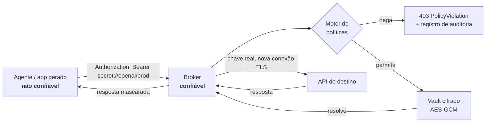
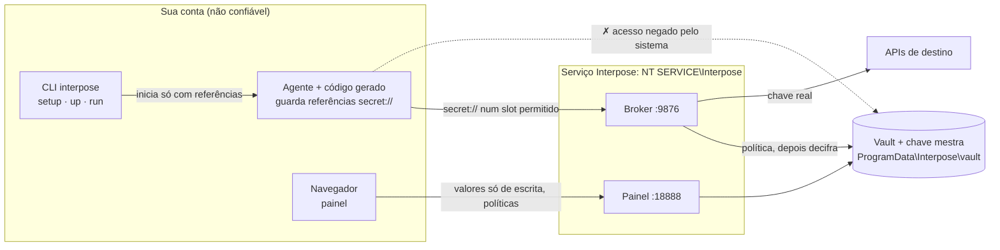

[English](README.md) | **Português (Brasil)**

# Interpose

**Interposição de credenciais para agentes de IA não confiáveis.**

[](https://github.com/Coelhomicka/interpose-agent/actions/workflows/ci.yml)
[](LICENSE)
[](https://www.python.org/downloads/)
[](#status-do-projeto)

Agentes de código escrevem arquivos `.env`, rodam comandos no shell e colam configurações em
prompts. Cada um desses lugares pode acabar guardando uma chave de API real. O Interpose tira a
chave do alcance do agente por completo: o agente recebe uma referência opaca, e um broker local
confiável faz a requisição autenticada no lugar dele.

```dotenv
# o que o agente vê, escreve e pode vazar
OPENAI_API_KEY=secret://openai/prod
OPENAI_BASE_URL=http://127.0.0.1:9876/proxy/api.openai.com/v1
```

O cliente HTTP do agente funciona sem modificação. A chave em texto puro nunca entra no processo,
no ambiente, nos argumentos, nos logs nem na janela de contexto do agente.

O nome é o mecanismo. *Interposição* é a prática de colocar uma camada confiável entre quem chama e
o recurso que ele quer alcançar — a chamada continua funcionando, e quem chama nunca segura o que
faz ela funcionar.

---

## Como funciona



A ordem importa: **a política é avaliada antes de o segredo ser resolvido.** Uma requisição para um
destino que a política não permite é negada enquanto o valor ainda está cifrado em repouso.

### Onde cada peça roda



No Windows, o `interpose setup` instala o broker e o painel como um serviço com identidade própria
no sistema operacional, então o vault fica fora do alcance de tudo que roda como você — inclusive o
agente. Sem ele (modo de desenvolvimento, e hoje no Linux e no macOS) os mesmos componentes rodam
como você, a partir do `interpose up`. O [`docs/pt-br/ARCHITECTURE.md`](docs/pt-br/ARCHITECTURE.md)
tem a visão completa, os fluxos de instalação e de login, e o ciclo de vida de uma requisição.

## Instalação

Com o [pipx](https://pipx.pypa.io), para o comando `interpose` funcionar em qualquer terminal:

```bash
python -m pip install --user pipx
python -m pipx ensurepath        # depois abra um terminal novo
pipx install git+https://github.com/Coelhomicka/interpose-agent.git
interpose setup                  # Windows: protege o vault (veja abaixo)
```

Para trabalhar no código do Interpose, use um ambiente virtual:

```bash
python -m venv .venv
source .venv/bin/activate       # Windows: .\.venv\Scripts\Activate.ps1
python -m pip install -e ".[dev]"
```

O estado do runtime fica em `~/.interpose` (`%USERPROFILE%\.interpose` no Windows). Mantenha o
shell administrativo, o banco e a chave mestra fora do workspace do agente.

### Proteja o vault: instale o serviço (Windows)

Por padrão o broker roda como você, então qualquer programa rodando como você, incluindo o agente,
consegue ler o vault e a chave do disco. Instale o serviço uma vez para fechar isso:

```powershell
interpose setup        # um prompt de administrador (UAC); nunca mais depois disso
```

O `setup` copia um runtime Python próprio e o Interpose para `%ProgramFiles%\Interpose`, registra o
serviço `Interpose` na conta virtual `NT SERVICE\Interpose` (sem senha, sem login) e move o seu
vault para `%ProgramData%\Interpose\vault`, que só essa conta, o SYSTEM e administradores elevados
conseguem abrir. A cópia no seu perfil é destruída.

O serviço **não** inicia com o Windows. Como o `aspire run`, o `interpose up` inicia o serviço, abre o
painel e fica rodando no terminal; **Ctrl+C para o serviço**. O `setup` permite que a sua conta
inicie e pare só esse serviço, então nada disso exige administrador. Enquanto ele roda, o
`interpose run` aponta as sessões para ele. Nada mais muda para o agente.

Rode o `setup` você mesmo, não de dentro de uma sessão de agente: até o serviço existir, o código de
onde ele instala ainda pode ser alterado por esse agente. Nunca rode um agente elevado; um
administrador consegue ler qualquer coisa. `interpose service status|start|stop|uninstall`
gerenciam o serviço; o `uninstall` mantém o vault, a menos que você passe `--purge`.

No `session.yaml`, escreva as URLs do broker como `${INTERPOSE_PROXY}/<host>`. Isso vira o endereço
do broker para o projeto atual, com ou sem o serviço.

## Começo rápido: o painel

Na pasta do seu projeto:

```bash
interpose up
```

```text
  Interpose
  Project:    my-app (C:\code\my-app)
  Proxy:      http://127.0.0.1:9876
  Dashboard:  http://127.0.0.1:18888/login?t=…
              (single-use login link; restart for a new one)
```

Isso sobe o broker e um painel local num único processo e abre o painel no navegador, no estilo do
painel do .NET Aspire. Com o [serviço](#proteja-o-vault-instale-o-serviço-windows) instalado, o
`interpose up` inicia o serviço, confere que ele é dono das duas portas, pede a ele um link de login
de uso único vinculado à pasta atual e o abre; o Ctrl+C para o serviço de novo. A partir dali você
pode:

- **registrar a pasta como projeto** — os segredos e políticas dele só valem quando o runtime roda
  ali;
- **adicionar segredos** ao projeto ou ao escopo global. Os valores são só de escrita: são cifrados
  ao enviar, e nenhuma tela ou endpoint os devolve;
- **escrever políticas** com um formulário — hosts, métodos, caminhos e onde a credencial pode
  aparecer — com prévia do YAML ao vivo;
- **acompanhar a atividade** ao vivo: cada requisição permitida e negada, com o motivo e o local da
  referência;
- **copiar um `.env` e um `session.yaml`** para o agente, gerados a partir do que está configurado.

### Escopos de projeto e global

A mesma referência pode significar valores diferentes em lugares diferentes. Dentro de um projeto
registrado, `secret://openai/prod` resolve para o valor do projeto, se existir, e para o valor
global caso contrário. As políticas seguem a mesma cadeia, então uma política de projeto pode
restringir — ou ampliar — como um segredo global compartilhado é usado só naquele projeto.

Qual projeto está ativo vem do registro que o operador gerencia no painel, nunca de um arquivo no
repositório. Um agente que edita o workspace não consegue apontar a sessão dele para os segredos de
outro projeto. Os textos cifrados de projeto também ficam vinculados ao escopo pelos dados
associados do AES-GCM, então mover uma linha entre escopos no banco faz a decifragem falhar, em vez
de resolver no lugar errado.

O link de login do painel funciona uma vez e vira um cookie de sessão `HttpOnly` e
`SameSite=Strict`. O painel rejeita headers `Host` fora do loopback e requisições de outra origem,
exige um token CSRF por sessão em toda alteração e serve uma Content Security Policy restritiva.

## Começo rápido: a CLI

**1. Guarde um segredo** por um prompt oculto — o valor nunca é exibido nem passado como argumento:

```bash
interpose secret add openai/prod
interpose secret list
```

**2. Conceda uma capacidade.** As políticas vêm de um arquivo controlado pelo operador. Um perfil de
sessão nunca pode conceder uma, então um agente não consegue se autorizar editando um arquivo do
projeto:

```yaml
# openai-policy.yaml
secret: openai/prod

allow:
  hosts:
    - api.openai.com

methods:
  - GET
  - POST

# Opcional: restringe quais caminhos do destino podem usar a credencial.
paths:
  - /v1/*

# Opcional: onde, na requisição, a referência pode aparecer. Se omitido, só os
# headers Authorization e X-API-Key são aceitos.
inject:
  - header: Authorization
```

**Onde uma referência pode aparecer faz parte da política.** O broker registra onde cada referência
está numa requisição — qual header, qual campo de query ou de formulário, ou o corpo — e nega
qualquer ocorrência fora dos slots `inject` da política *antes* de resolvê-la. Sem isso, um host
permitido vira um canal de exfiltração: uma referência no corpo de um `POST api.github.com/gists`
seria publicada pela própria API que ela autentica, e uma colocada numa mensagem de chat poderia ser
ecoada de volta numa forma transformada que o mascaramento por valor exato não pega. Use entradas
`query: key` ou `form: token` para APIs que recebem a credencial nesses lugares.

```bash
interpose policy add openai-policy.yaml
interpose policy list
```

**3. Declare a sessão.** O perfil liga nomes de variáveis convencionais a referências:

```yaml
# session.yaml
version: 1

environment:
  OPENAI_API_KEY: secret://openai/prod

public_environment:
  OPENAI_BASE_URL: ${INTERPOSE_PROXY}/api.openai.com/v1
```

`${INTERPOSE_PROXY}` vira o endereço do broker para o projeto da pasta atual, por exemplo
`http://127.0.0.1:9876/p/my-app/proxy`, então o mesmo perfil funciona no desenvolvimento e com o
serviço. Uma URL literal `http://127.0.0.1:9876/proxy/...` também funciona; ela usa o escopo do
próprio broker.

**4. Suba o broker** num terminal confiável — pule este passo com o serviço instalado:

```bash
interpose proxy --host 127.0.0.1 --port 9876
```

**5. Rode o agente** com um ambiente limpo:

```bash
interpose run --profile session.yaml -- claude
```

O processo filho recebe `OPENAI_API_KEY=secret://openai/prod`, mais `INTERPOSE_PROXY` com o endereço
do broker para o projeto atual. Credenciais herdadas do seu shell são removidas — o ambiente é
reconstruído a partir de uma lista de permissão — e o launcher nunca repassa `INTERPOSE_MASTER_KEY`
nem `INTERPOSE_HOME` ao filho. Rode a partir de um terminal normal: ele recusa um de administrador.

O launcher não se importa com o que está iniciando — ele repassa o comando sem alterações:

```bash
interpose run --profile session.yaml -- codex
interpose run --profile session.yaml -- cursor
interpose run --profile session.yaml -- gemini
interpose run --profile session.yaml -- python my_script.py
```

Existe uma opção `--agent NOME`. Ela é só um rótulo para os registros de auditoria: nenhuma política
depende dela e nenhum comportamento muda com ela. Veja
[a atribuição na auditoria](#a-atribuição-na-auditoria-é-autodeclarada) antes de confiar nela.

## O que o Interpose consegue e não consegue envolver

A ferramenta que você roda importa, mas não porque o Interpose conhece o nome dela. Uma ferramenta
funciona com o broker quando cumpre duas condições:

**1. Ela herda o ambiente que o Interpose monta.** O launcher controla o processo que inicia e os
filhos desse processo. O que já está rodando não é afetado.

Por isso agentes de CLI encaixam naturalmente e extensões de IDE em geral não. Uma extensão roda
dentro do processo do editor, então o próprio editor precisa ser iniciado pelo Interpose:

```bash
interpose run --profile session.yaml -- code .
```

> **Atenção:** se uma janela do editor já estiver aberta, o `code .` normalmente só avisa a instância
> em execução e sai. A nova janela é servida pelo processo antigo, com o ambiente antigo — então nada
> fica protegido, e nada avisa você. Feche todas as janelas antes, ou use um diretório de perfil
> separado para a sessão gerenciada.

**2. Ela deixa você apontar a credencial para outra URL base.** O broker só vê requisições
endereçadas a ele. Uma ferramenta que lê `OPENAI_BASE_URL`, `ANTHROPIC_BASE_URL` ou uma configuração
equivalente pode ser redirecionada. Uma ferramenta que guarda a chave no armazenamento de segredos do
próprio editor e chama o endpoint do fornecedor diretamente não pode — não há onde colocar uma
referência nem o que redirecionar.

Se uma ferramenta tem uma configuração de endpoint personalizado na interface, aponte-a para o
broker e coloque a referência `secret://` no campo da chave. Isso funciona mesmo quando a ferramenta
não é iniciada pelo Interpose, desde que o broker esteja rodando.

Verifique uma sessão com `interpose env validate` e acompanhando o log de auditoria: se as
requisições não aparecem lá, a ferramenta está acessando a rede por conta própria.

## Verificando sem resolver

Todos os caminhos de validação trabalham só com referências. Nenhum deles decifra nada:

```bash
interpose profile validate session.yaml
interpose profile env session.yaml
interpose env validate .env --profile session.yaml    # confere o que o agente escreveu
```

O `env validate` protege contra a falha mais comum: um agente que, "querendo ajudar", troca uma
referência por um valor em texto puro, um placeholder `****` ou um token inventado.

## Ensinando as regras ao agente

Agentes trabalham melhor quando sabem como o Interpose funciona: chamar
`$INTERPOSE_PROXY/<host>/<caminho>` com a referência no header `Authorization`, entender
`[REDACTED]` e `403 PolicyViolation`, e pedir que você cadastre uma credencial que falte no painel
em vez de pedir a chave.

```bash
interpose agents install            # num projeto: AGENTS.md, CLAUDE.md, GEMINI.md, regra do Cursor
interpose agents install --global   # nível de usuário: skill do Claude Code, ~/.codex/AGENTS.md, ~/.gemini/GEMINI.md
interpose agents print              # o mesmo texto, para colar numa tela de configuração
```

O `AGENTS.md` é lido por Codex, Cursor, Devin, Antigravity, GitHub Copilot, Jules, Amp, Windsurf e
outros; o `CLAUDE.md` e a skill cobrem o Claude Code; o `GEMINI.md` cobre o Gemini CLI e o
Antigravity. Para ferramentas configuradas só por uma tela de ajustes — o Knowledge do Devin, as
User Rules do Cursor — cole a saída do `interpose agents print`. Arquivos compartilhados recebem um
bloco marcado, que reinstalar substitui e o `interpose agents remove` apaga; o resto do arquivo nunca
é alterado. O `interpose setup` instala os arquivos de nível de usuário para os agentes que
encontrar.

O `interpose run` também coloca `INTERPOSE_PROXY` no ambiente do agente, já apontando para o projeto
atual, então as instruções funcionam sem mudanças em qualquer projeto.

As instruções são só orientação: um agente que as ignora não ganha nada, porque quem aplica as regras
é o broker e o sistema operacional. O
[`docs/pt-br/AGENT_CREDENTIALS.md`](docs/pt-br/AGENT_CREDENTIALS.md) descreve o mesmo contrato como
documento de referência.

## Transportes suportados

| Transporte | Situação |
| --- | --- |
| Transporte local explícito `http://127.0.0.1:9876/proxy/{host}/{path}` | Implementado — recomendado |
| Transporte por projeto `http://127.0.0.1:9876/p/{projeto}/proxy/{host}/{path}` | Implementado — é o que `${INTERPOSE_PROXY}` gera |
| TLS externo iniciado pelo broker (ele abre a própria conexão HTTPS) | Implementado |
| Política com esquema (HTTP externo inseguro negado por padrão) | Implementado |
| Substituição em query, formulário, corpo JSON e headers | Implementado |
| Proxy de encaminhamento HTTP via `HTTP_PROXY` | Só compatibilidade |
| HTTPS `CONNECT` | **Rejeitado de propósito** |
| Interceptação HTTPS transparente | Não implementado — exige uma CA por sessão e tratamento de pinning |
| Autenticação de banco, SSH, mTLS, assinatura SigV4 | Não implementado — exige brokers de protocolo |

O `CONNECT` retorna `501` em vez de tunelar em silêncio. Um broker que não vê a requisição não
consegue aplicar política sobre ela, e fingir o contrário seria uma garantia falsa.

## Status do projeto

**Alpha.** O modelo de referências, o motor de políticas, o broker, o painel e a auditoria funcionam
e têm testes. No Windows, o vault agora fica atrás de uma fronteira do sistema operacional (o
serviço); o controle de saída de rede e a confirmação de presença do usuário no painel ainda não
estão prontos, e são eles a diferença entre *aplicar políticas* e *conter um adversário*.

Garantido hoje:

- nenhuma operação da API ou da CLI retorna um valor de segredo armazenado;
- com o serviço do Windows instalado, o vault e a chave mestra são ilegíveis para a sua conta, a
  memória do serviço não pode ser aberta pelos seus processos, e o serviço executa código que a sua
  conta não pode alterar;
- o `interpose run` se recusa a iniciar um agente a partir de um terminal de administrador (um agente
  elevado derruba todas as fronteiras), a menos que você passe `--allow-elevated`;
- o `interpose-exec` nunca coloca um segredo resolvido numa linha de comando;
- a política é avaliada antes da resolução;
- os ambientes dos filhos gerenciados contêm referências, não valores;
- o armazenamento usa criptografia autenticada AES-GCM;
- as respostas são mascaradas para os valores resolvidos conhecidos;
- os registros de auditoria guardam só referências e metadados.

**Ainda não** garantido:

- **isolamento de outro processo rodando com o mesmo usuário sem o serviço**: no modo de
  desenvolvimento, um processo do mesmo usuário consegue ler o arquivo do vault e a chave mestra. O
  `interpose setup` move os dois para uma identidade separada no sistema (só no Windows, por
  enquanto). Mesmo com o serviço, o token de controle do painel é legível pelo usuário, então um
  processo do mesmo usuário ainda consegue abrir uma sessão no painel e alterar políticas (nunca ler
  valores); exigir o Windows Hello para isso é o próximo passo;
- **bloqueio da saída direta de rede** — nada impede um agente de abrir o próprio socket e contornar
  o broker. Controle de saída no sistema operacional é obrigatório para um modelo de ameaças real;
- proteção contra processos rodando como administrador ou SYSTEM;
- proteção contra exfiltração por DNS ou por canais encobertos;
- compatibilidade com SDKs que validam o *formato* do token localmente antes de qualquer requisição;
- atribuição de uma requisição do broker a um agente específico — veja abaixo.

### A atribuição na auditoria é autodeclarada

O broker aceita requisições no loopback sem autenticar o cliente, então não consegue verificar
*qual* processo enviou cada uma. O rótulo `--agent` que você passa ao `interpose run` chega ao
ambiente do filho, mas não ao broker, o que significa que os registros do lado do broker hoje levam o
nome de agente do próprio broker — na prática `unknown` — independentemente do que você passou.

Os registros de auditoria são confiáveis sobre *o que aconteceu*: a referência usada, o destino, a
decisão da política e o status do destino. Não são confiáveis sobre *quem fez* quando mais de uma
sessão gerenciada compartilha um broker. Atribuição verificada por agente depende do daemon
autenticado previsto no [roadmap](docs/pt-br/ROADMAP.md); qualquer coisa possível antes disso é
autodeclarada por um processo não confiável e, portanto, falsificável.

O [`docs/pt-br/THREAT_MODEL.md`](docs/pt-br/THREAT_MODEL.md) tem a análise completa por ameaça. Ele
foi escrito para ser honesto sobre o que não funciona, não para vender o que funciona.

## Plataformas suportadas

| | Núcleo (vault, políticas, broker, CLI, auditoria) | Isolamento com AppContainer |
| --- | --- | --- |
| Windows | Suportado, mais o serviço protegido (`interpose setup`) | Suportado (exige terminal elevado) |
| Linux | Suportado | Não implementado — veja o [roadmap](docs/pt-br/ROADMAP.md) |
| macOS | Suportado | Não implementado — veja o [roadmap](docs/pt-br/ROADMAP.md) |

## Executor limitado

O `interpose-exec` roda o `curl` com o segredo real:

```bash
interpose-exec --agent codex curl "https://api.github.com/user" \
  -H "Authorization: Bearer secret://github/prod"
```

Os argumentos que carregam uma referência são passados ao `curl` pela entrada padrão, como config do
curl (`--config -`), então o valor resolvido nunca aparece na lista de processos. O próprio `curl`
ainda **tem** o valor em texto puro enquanto roda. Prefira o broker, onde o segredo nunca entra em
nenhum processo filho.

Por isso, ele fica **desligado a menos que a política o ative** com `allow_exec: true`. Mesmo assim:

- só o `curl` roda com referências de segredo; qualquer outro programa é recusado;
- um valor com barra invertida ou caractere de controle é recusado em vez de enviado alterado, porque
  a sintaxe de config do curl não o preserva de forma confiável;
- destinos do `curl` sem esquema, como `evil.example/path`, contam como destinos, então não podem ir
  junto com uma URL `https://` permitida;
- opções do `curl` que redirecionam o tráfego ou leem argumentos de outro lugar (`-K/--config`,
  `--next`, `-x/--proxy`, `--resolve`, `--connect-to`, `-L/--location` e similares) são recusadas;
- um `--destination` explícito é recusado se o comando também endereça outro host.

Inferir o destino pelos argumentos é uma heurística. Trate o `allow_exec` como aceitar esse risco.

## API administrativa

```bash
interpose api --host 127.0.0.1 --port 8000
```

`GET /health` · `GET|POST /secrets` · `DELETE /secrets/{id}` · `GET|POST /policies` · `GET /audit`

Nenhum endpoint retorna um valor de segredo. Ao iniciar, a API imprime um token de administração de
uso único no terminal do operador; toda rota exceto `/health` exige
`Authorization: Bearer <token>`. O token fica só em memória e nunca é gravado em disco, onde um
agente rodando com o mesmo usuário poderia lê-lo. Sem ele, qualquer processo local poderia registrar
uma política liberando o próprio host e então gastar o segredo pelo broker.

A API e o broker se recusam a escutar num endereço fora do loopback, rejeitam requisições cujo
`Host` não seja loopback (DNS rebinding) e rejeitam requisições com header `Origin` de navegador ou
`Sec-Fetch-Site` cross-site, para que uma página web não consiga acioná-los.

## Documentação

- [Arquitetura](docs/pt-br/ARCHITECTURE.md) — componentes, ciclo de vida das requisições, fronteira de confiança
- [Modelo de Ameaças](docs/pt-br/THREAT_MODEL.md) — situação por ameaça, garantias e o que não é garantido
- [Contrato de Credenciais para Agentes](docs/pt-br/AGENT_CREDENTIALS.md) — as regras para passar ao agente
- [Roadmap](docs/pt-br/ROADMAP.md) — do isolamento aplicado (V2) às integrações com agentes (V5)

A versão em inglês da documentação é a de referência: [docs/en](docs/README.md).

## Contribuindo

Contribuições são bem-vindas — veja o [CONTRIBUTING.md](CONTRIBUTING.md) (em inglês). O trabalho que
mais faz o projeto avançar agora está listado lá, começando pelo controle de saída de rede e pelo
serviço no Linux e no macOS.

Para relatar uma vulnerabilidade de segurança, siga o [SECURITY.md](SECURITY.md) em vez de abrir uma
issue pública.

## Licença

Apache License 2.0 — veja [LICENSE](LICENSE).
