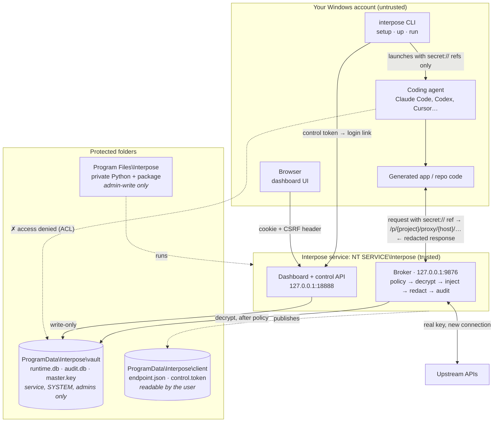
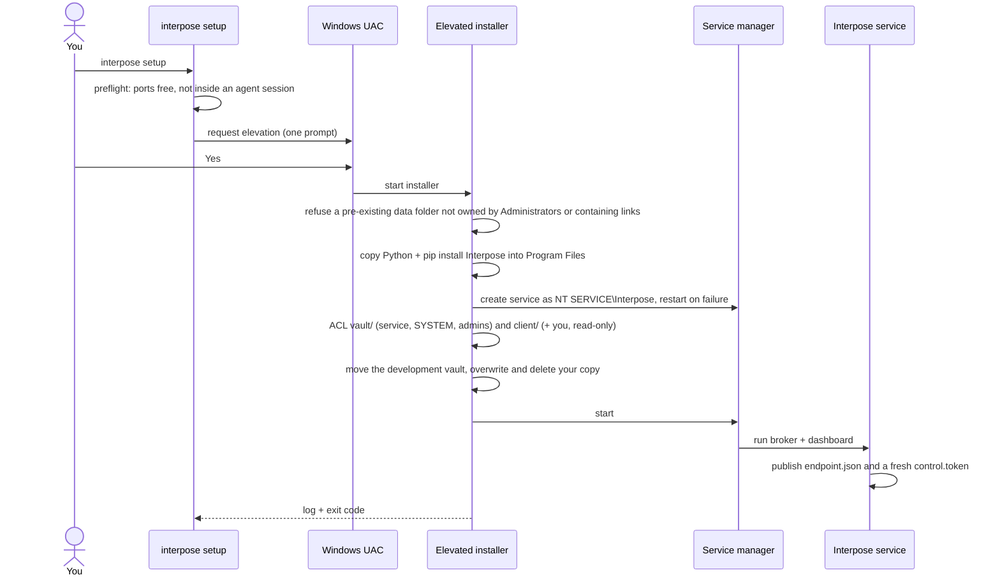
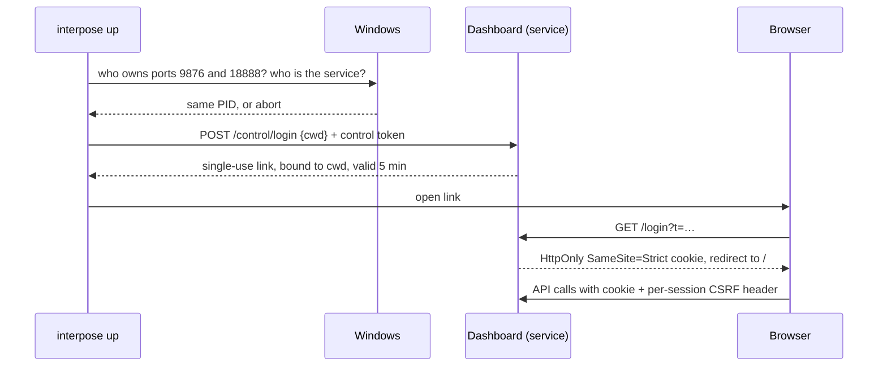
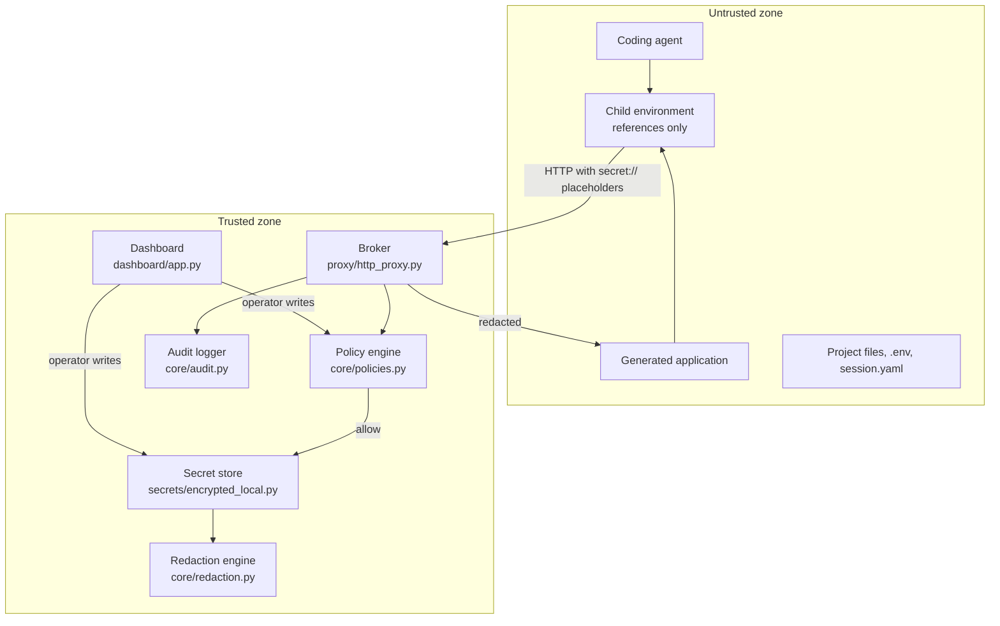

**English** | [Português (Brasil)](../pt-br/ARCHITECTURE.md)

# Architecture

This document describes how Interpose is put together and, more importantly, *where the trust
boundary sits*. Contributions that move that boundary need an issue first — see
[CONTRIBUTING.md](../../CONTRIBUTING.md).

## The core idea

Conventional secret managers answer the question "what is the value of this credential?" That
question is unanswerable safely when the caller is an AI agent, because the answer immediately
becomes part of a filesystem, a process environment, a log, and a context window.

Interpose never answers it. It answers a different question: *"perform this operation, which
happens to require a credential."* The untrusted side holds a reference; the trusted side holds the
value and performs the operation.

## System overview

With the service installed (`interpose setup`, Windows), every trusted component runs in one
process under its own OS identity, and the operating system — not the agent's good behavior — keeps
the vault out of reach:

What each zone may do:

| Zone | Holds | Can | Cannot |
| --- | --- | --- | --- |
| Your account (agent, app, CLI, browser) | `secret://` references, the proxy URL, the control token | Send requests through the broker; open a dashboard session | Read the vault or the key; change the code the service runs; read a value back from any endpoint |
| Service (`NT SERVICE\Interpose`) | The decrypted key, only while a request is in flight | Decrypt, inject into an allowed slot, redact, audit | Bind to anything but loopback; follow redirects; tunnel `CONNECT` |
| Administrators / SYSTEM | Everything | Everything | — an elevated agent defeats every boundary here |

## Deployment modes

| | Development mode | Service mode |
| --- | --- | --- |
| Started by | `interpose up` (foreground, one terminal) | `interpose setup`, once; then the Windows service manager |
| Runs as | You | `NT SERVICE\Interpose`, token reduced to `SeChangeNotifyPrivilege` |
| Code | Your virtual environment | Private copy under `%ProgramFiles%\Interpose` |
| Vault and key | `%USERPROFILE%\.interpose` | `%ProgramData%\Interpose\vault` |
| An agent running as you can read the vault | **Yes** | No — the OS denies it |
| `interpose up` | Starts broker + dashboard, prints a login link | Verifies the service owns both ports, asks it for a login link |
| Platforms | Windows, Linux, macOS | Windows |

Development mode is the right place to try Interpose and to hack on it. It enforces policy but does
not contain an adversary: a same-user process can open the vault file directly instead of going
through the broker. Service mode turns the policy boundary into an enforcement boundary for
everything below administrator.

### What `interpose setup` does

The installer copies the Python runtime instead of reusing yours because your interpreter lives in
your profile: an agent could patch it and the service would then run the agent's code with access to
the key. For the same reason, run `setup` yourself and never from inside an agent session — until it
finishes, everything it installs from is still writable by that agent.

### Opening the dashboard in service mode

The port check exists because a process that binds the dashboard port first could pose as the
dashboard and collect the values you type into it. The control routes refuse any request carrying
`Origin` or `Sec-Fetch-*` headers, so a web page cannot reach them even though it shares loopback.

> **Open gap.** `control.token` is readable by your account, so a same-user process can mint a
> login link and change policies or replace values through the dashboard — never read one. Requiring
> Windows Hello user presence to open a session closes this and is the next planned step.

## Trust boundary

Everything in the untrusted zone is assumed hostile: the agent may be prompt-injected, the generated
code may be malicious, and project files may have been written by either.

The launcher (`session/launcher.py`) is the gate between the two. It builds the child environment
from an allowlist rather than inheriting the parent's, so credentials already present in the
operator's shell do not cross into the agent session, and it never passes
`INTERPOSE_MASTER_KEY` or `INTERPOSE_HOME` to the child.

Policy, values and the project registry are only ever written by the operator, through the
dashboard or the CLI. Nothing in the workspace — `session.yaml`, `.env`, any project file — can grant
a capability or select a project.

## Components

| Module | Responsibility |
| --- | --- |
| `core/references.py` | Parse and normalize `secret://provider/namespace/path`; discover references nested in arbitrary payloads |
| `core/policies.py` | Policy documents, SQLite-backed repository, and the engine that decides allow/deny |
| `core/substitution.py` | Replace references with resolved values across strings, mappings, and sequences |
| `core/scopes.py` | Global and project scopes, and the resolution chain (project, then global) |
| `core/local_guard.py` | Loopback, `Host`, and browser-origin checks shared by the broker and admin API |
| `core/redaction.py` | Register resolved values and strip them, and their encoded variants, from responses |
| `core/audit.py` | Append-only SQLite record of references, destinations, decisions, and timings — never values |
| `projects.py` | Operator-controlled registry mapping folders to project scopes |
| `secrets/base.py` | The `SecretStore` protocol; the seam for external stores |
| `secrets/encrypted_local.py` | AES-GCM vault with per-record nonces, scope-bound associated data, keyed fingerprints |
| `proxy/http_proxy.py` | The broker: target parsing, per-project scope, policy check, resolution, upstream request, redaction |
| `dashboard/` | Configuration dashboard and, under the service, the `/control/` routes clients use |
| `service/host.py` | The service process: broker and dashboard on loopback, endpoint publication |
| `service/winsvc.py` | Windows service-manager glue in ctypes (no native dependency) |
| `service/install.py` | `interpose setup`: elevation, private runtime, service registration, ACLs, vault migration |
| `service/client.py`, `service/win32.py` | How the CLI finds the service and verifies it owns its ports |
| `executor/trusted_executor.py` | `interpose-exec` compatibility mode — substitutes into subprocess arguments |
| `session/profile.py` | Session profile parsing and validation; enforces that profiles cannot grant policy |
| `session/launcher.py` | Environment allowlist, `${INTERPOSE_PROXY}` expansion, and child process launch |
| `session/isolation/` | OS-level isolation backends behind the `IsolationBackend` protocol |
| `api/app.py` | Administrative FastAPI app for development mode; no endpoint returns a value |
| `cli/main.py` | The `interpose` and `interpose-exec` entry points |
| `container.py` | Composition root — wires every component from `RuntimeConfig` |

`create_container()` is the single place where dependencies are assembled. Tests build their own
container against a temporary runtime home rather than patching globals.

## Request lifecycle

The broker's path for a single request, in order — the order *is* the security property:

0. **Reject browser and rebound requests.** An `Origin` header, a cross-site `Sec-Fetch-Site`, or —
   on the local transport — a non-loopback `Host` returns `403`.
1. **Reject `CONNECT`.** Returns `501`. An opaque TLS tunnel cannot be inspected, so policy cannot
   be enforced on it and no guarantee is claimed.
2. **Select the scope.** A `/p/{project}/` prefix selects that registered project's scope (then
   global) for this request; an unknown project returns `404`. Without the prefix the broker uses
   its own scope — the folder `interpose up` started in, or global only under the service.
3. **Parse the destination.** `parse_local_transport_target()` derives the upstream authority from
   `/proxy/{host}/{path}`. Loopback destinations default to `http`; everything else defaults to
   `https`. Embedded credentials in the authority are rejected.
4. **Discover references.** `collect_secret_references()` walks headers, query pairs, and the body —
   decoding JSON and form encodings first, so a reference hidden inside a URL-encoded parameter is
   still found.
5. **Evaluate policy — before resolution.** Every discovered reference is checked against its policy
   for scheme, method, destination host, path, and *location*: the header, query field, form field,
   or body it was found in. A location outside the policy's `inject` slots (default: the
   `Authorization` and `X-API-Key` headers) is denied. Any denial returns `403`, writes an audit
   record, and the secret is never decrypted.
6. **Resolve and substitute.** Only now does the vault decrypt. Values are substituted into headers,
   query parameters, and the body according to content type, then re-encoded safely.
7. **Register for redaction.** Every resolved value is added to the redaction engine before the
   upstream call, so it can be caught in a response or an error trace.
8. **Call upstream.** A new connection with `follow_redirects=False` and `trust_env=False`, so the
   broker does not follow a redirect to an unvetted host or inherit proxy settings from the
   environment.
9. **Redact the response.** Headers and body are scrubbed of known resolved values and their
   trimmed, URL-encoded, and base64 forms. Hop-by-hop headers, and the upstream's `Server` and
   `Date`, are dropped.
10. **Audit.** Reference, destination, method, decision, location, upstream status, and duration are
    recorded. The resolved URL is redacted before it is persisted.

## Data model

**References** are `secret://provider/namespace/path`, normalized to lowercase canonical form.
Shorthand like `APIChave/teste` normalizes to `secret://apichave/teste`.

**Storage.** Each record holds the AES-GCM ciphertext, its nonce, and an HMAC-SHA256 fingerprint of
the plaintext keyed from the master key. The fingerprint supports equality checks and audit
correlation without retaining the value, and — unlike a bare hash — cannot be used to test guesses
offline. Values are trimmed on write, so a pasted leading space cannot defeat redaction.

**Master key.** Read from `master.key` in the runtime home, generated with `os.urandom(32)` on first
use and created exclusively with an ACL for the creating account alone; in development mode
`INTERPOSE_MASTER_KEY` may override it, the service never honors that variable. The key passes
through SHA-256 to produce the 32-byte AES key. Where the file lives decides who can read it: your
profile in development mode, the service's vault folder in service mode.

**Scopes.** Secrets and policies are keyed by `(scope, reference)`, where scope is `global` or
`project:<id>`. Resolution walks the active chain — project first, then global — independently for
the value and for the policy. Project ciphertexts use `scope|reference` as AES-GCM associated data;
global ones keep the bare reference, so vaults from before scopes existed still decrypt and are
migrated in place on open.

**Projects** map a folder to a project id. The nearest registered ancestor of a folder wins. The
registry lives in the vault database, so only the operator can register or move a project.

**Policies** are stored one per secret reference and scope, keyed uniquely. Adding a policy for an
existing reference replaces it. A reference with no policy is denied: the default is closed.

**Audit records** are append-only and contain a reference, destination, action, decision, status,
duration, and a JSON details blob. Values never enter this table.

## Extension points

Three protocols are the intended seams for contributions:

- **`SecretStore`** (`secrets/base.py`) — implement `store`, `resolve`, `list`, `delete` to back the
  runtime with Vault, a cloud secret manager, or an OS keychain.
- **`IsolationBackend`** (`session/isolation/base.py`) — implement `run(command, environment, cwd)`
  for a platform. `windows_appcontainer.py` is the reference implementation; it derives a container
  SID, applies ACLs, and installs firewall rules scoped to that SID so the child can reach the
  broker port and nothing else on loopback.
- **Protocol brokers** — the HTTP broker is one instance of a general shape: accept an operation
  containing references, check policy, resolve inside the trusted zone, perform the operation,
  return a redacted result. Database authentication, SigV4 signing, SSH, and mTLS all fit this shape
  and none of them require handing key material out.

The service layer is the fourth, informal seam: a Linux (systemd `DynamicUser=`) or macOS
(launchd daemon with a dedicated user) host would reuse `service/host.py` unchanged and replace only
the install and service-manager glue.

## Design decisions worth knowing

**Policy is never sourced from the agent's workspace.** Session profiles bind names to references
but cannot grant capabilities. If a profile could grant policy, an agent that can write project
files could authorize itself — which would make the entire policy engine decorative.

**The service needs no password and no second login.** A Windows virtual account is an identity the
OS manages for one service. It gives the vault an owner that is not you without asking you to
create or remember anything; the one-time UAC prompt is the only administrator interaction.

**The service ships its own runtime.** Loading Python or packages from a user-writable folder would
let an agent run code inside the service. Copying them under Program Files costs disk space and
buys an enforcement boundary.

**`CONNECT` fails loudly.** Silently tunneling would produce working software with a false security
claim. A `501` is a worse user experience and an honest one.

**Redaction is a safety net, not a defense.** The engine strips known resolved values and their
common encodings from responses. A value that is transformed further — hashed, split across a
boundary, re-encoded twice — can evade it. Injection slots keep references out of the places an
upstream would echo; redaction catches accidental reflection.

**Insecure external HTTP is denied by default.** Sending a resolved credential over plaintext HTTP to
a non-loopback host requires an explicit `schemes: [http]` in the policy.
