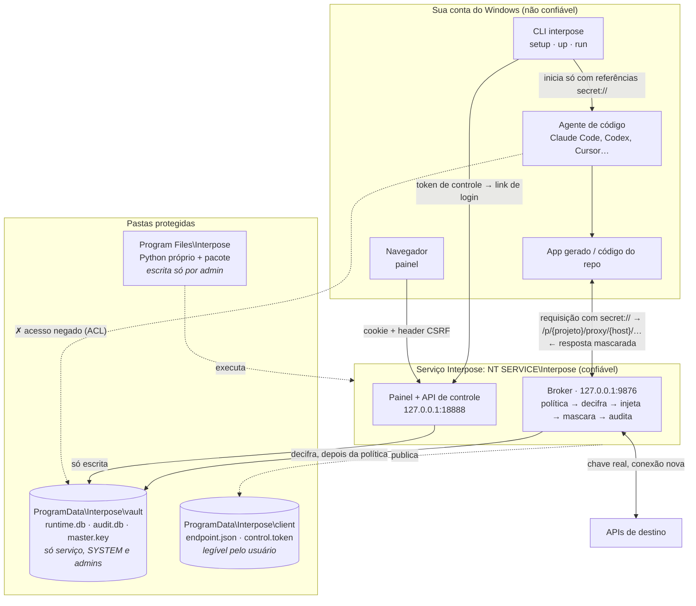
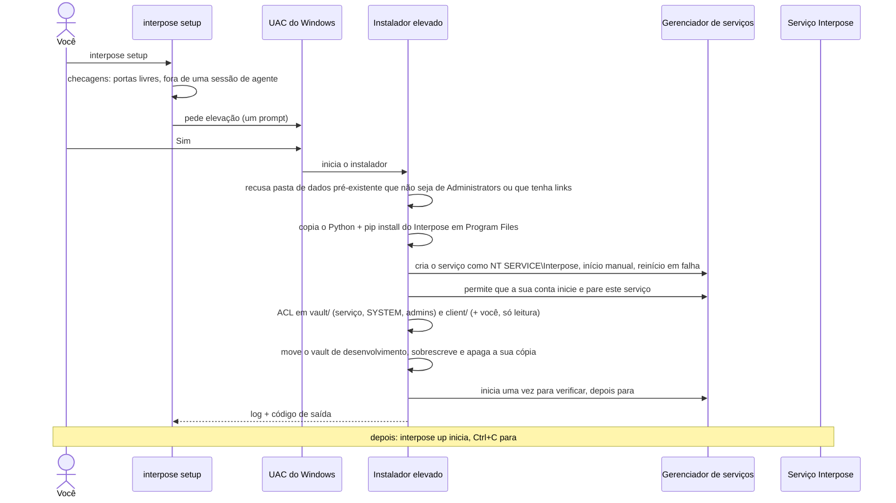
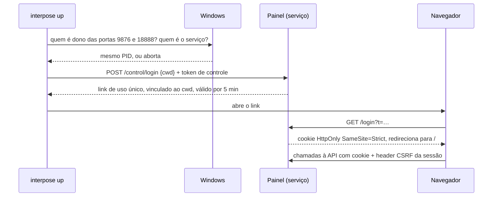
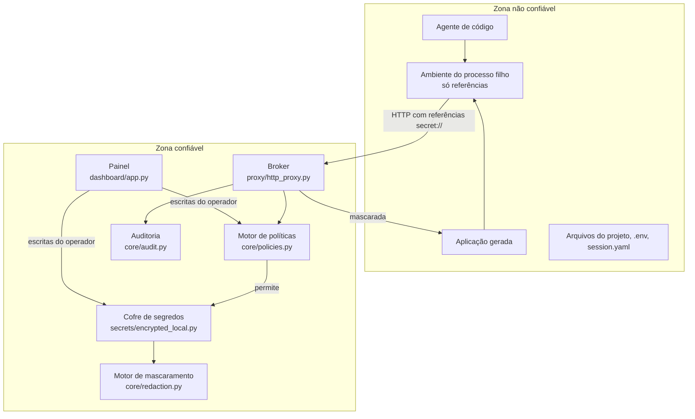

[English](../en/ARCHITECTURE.md) | **Português (Brasil)**

# Arquitetura

Este documento descreve como o Interpose é montado e, principalmente, *onde fica a fronteira de
confiança*. Contribuições que movem essa fronteira precisam de uma issue antes — veja o
[CONTRIBUTING.md](../../CONTRIBUTING.md).

## A ideia central

Gerenciadores de segredos convencionais respondem à pergunta "qual é o valor desta credencial?".
Essa pergunta não tem resposta segura quando quem pergunta é um agente de IA, porque a resposta
imediatamente vira parte de um sistema de arquivos, de um ambiente de processo, de um log e de uma
janela de contexto.

O Interpose nunca responde a ela. Ele responde a outra pergunta: *"execute esta operação, que por
acaso exige uma credencial."* O lado não confiável guarda uma referência; o lado confiável guarda o
valor e executa a operação.

## Visão geral do sistema

Com o serviço instalado (`interpose setup`, Windows), todos os componentes confiáveis rodam em um
único processo com identidade própria no sistema operacional, e é o sistema operacional — não o bom
comportamento do agente — que mantém o vault fora de alcance:

O que cada zona pode fazer:

| Zona | Guarda | Pode | Não pode |
| --- | --- | --- | --- |
| Sua conta (agente, app, CLI, navegador) | Referências `secret://`, a URL do proxy, o token de controle | Enviar requisições pelo broker; abrir uma sessão no painel | Ler o vault ou a chave; alterar o código que o serviço executa; ler um valor de volta por qualquer endpoint |
| Serviço (`NT SERVICE\Interpose`) | A chave decifrada, só enquanto uma requisição está em andamento | Decifrar, injetar num slot permitido, mascarar, auditar | Escutar fora do loopback; seguir redirecionamentos; tunelar `CONNECT` |
| Administradores / SYSTEM | Tudo | Tudo | — um agente elevado derruba todas as fronteiras aqui |

## Modos de execução

| | Modo de desenvolvimento | Modo serviço |
| --- | --- | --- |
| Iniciado por | `interpose up` (em primeiro plano, num terminal) | `interpose up`, que inicia o serviço instalado e o para no Ctrl+C; nunca no boot |
| Roda como | Você | `NT SERVICE\Interpose`, com o token reduzido a `SeChangeNotifyPrivilege` |
| Código | Seu ambiente virtual | Cópia própria em `%ProgramFiles%\Interpose` |
| Vault e chave | `%USERPROFILE%\.interpose` | `%ProgramData%\Interpose\vault` |
| Um agente rodando como você consegue ler o vault | **Sim** | Não — o sistema operacional nega |
| `interpose up` | Sobe broker + painel e imprime um link de login | Inicia o serviço, confere que ele é dono das duas portas, pede um link de login e o para no Ctrl+C |
| Plataformas | Windows, Linux, macOS | Windows |

O modo de desenvolvimento é o lugar certo para experimentar o Interpose e para trabalhar no código.
Ele aplica as políticas, mas não contém um adversário: um processo do mesmo usuário pode abrir o
arquivo do vault diretamente em vez de passar pelo broker. O modo serviço transforma a fronteira de
política em fronteira de aplicação para tudo abaixo de administrador.

### O que o `interpose setup` faz

O instalador copia o runtime do Python em vez de reaproveitar o seu porque o seu interpretador fica
no seu perfil: um agente poderia alterá-lo, e o serviço passaria a executar o código do agente com
acesso à chave. Pelo mesmo motivo, rode o `setup` você mesmo e nunca de dentro de uma sessão de
agente — até ele terminar, tudo de onde ele instala ainda pode ser alterado por esse agente.

### Abrindo o painel no modo serviço

A checagem de portas existe porque um processo que ocupe a porta do painel primeiro poderia se
passar pelo painel e coletar os valores digitados nele. As rotas de controle recusam qualquer
requisição com headers `Origin` ou `Sec-Fetch-*`, então uma página web não as alcança, mesmo
compartilhando o loopback.

> **Lacuna em aberto.** O `control.token` é legível pela sua conta, então um processo do mesmo
> usuário pode gerar um link de login e alterar políticas ou trocar valores pelo painel — nunca ler
> um valor. Exigir presença do usuário com o Windows Hello para abrir uma sessão fecha essa lacuna e
> é o próximo passo planejado.

## Fronteira de confiança

Tudo na zona não confiável é tratado como hostil: o agente pode sofrer prompt injection, o código
gerado pode ser malicioso e os arquivos do projeto podem ter sido escritos por qualquer um dos dois.

O launcher (`session/launcher.py`) é o portão entre as duas zonas. Ele monta o ambiente do processo
filho a partir de uma lista de permissão em vez de herdar o do processo pai, de modo que credenciais
já presentes no shell do operador não passam para a sessão do agente, e nunca repassa
`INTERPOSE_MASTER_KEY` nem `INTERPOSE_HOME` ao filho.

Políticas, valores e o registro de projetos só são escritos pelo operador, pelo painel ou pela CLI.
Nada no workspace — `session.yaml`, `.env`, qualquer arquivo do projeto — consegue conceder uma
capacidade ou escolher um projeto.

## Componentes

| Módulo | Responsabilidade |
| --- | --- |
| `core/references.py` | Interpreta e normaliza `secret://provider/namespace/path`; encontra referências aninhadas em payloads arbitrários |
| `core/policies.py` | Documentos de política, repositório em SQLite e o motor que decide permitir ou negar |
| `core/substitution.py` | Troca referências pelos valores resolvidos em strings, mapas e sequências |
| `core/scopes.py` | Escopos global e de projeto, e a cadeia de resolução (projeto, depois global) |
| `core/local_guard.py` | Checagens de loopback, `Host` e origem de navegador usadas pelo broker e pela API administrativa |
| `core/redaction.py` | Registra valores resolvidos e os remove, junto com suas variantes codificadas, das respostas |
| `core/audit.py` | Registro SQLite só de inserção com referências, destinos, decisões e tempos — nunca valores |
| `projects.py` | Registro, controlado pelo operador, que mapeia pastas para escopos de projeto |
| `secrets/base.py` | O protocolo `SecretStore`; o ponto de extensão para cofres externos |
| `secrets/encrypted_local.py` | Vault AES-GCM com nonce por registro, dados associados vinculados ao escopo e fingerprints com chave |
| `proxy/http_proxy.py` | O broker: interpretação do destino, escopo por projeto, checagem de política, resolução, requisição ao destino, mascaramento |
| `dashboard/` | Painel de configuração e, no serviço, as rotas `/control/` usadas pelos clientes |
| `service/host.py` | O processo do serviço: broker e painel no loopback, publicação do endpoint |
| `service/winsvc.py` | Integração com o gerenciador de serviços do Windows em ctypes (sem dependência nativa) |
| `service/install.py` | `interpose setup`: elevação, runtime próprio, registro do serviço, ACLs, migração do vault |
| `service/client.py`, `service/win32.py` | Como a CLI encontra o serviço e confere que ele é dono das portas |
| `executor/trusted_executor.py` | Modo de compatibilidade `interpose-exec` — substitui nos argumentos do subprocesso |
| `session/profile.py` | Leitura e validação do perfil de sessão; garante que perfis não concedem políticas |
| `session/launcher.py` | Lista de permissão do ambiente, expansão de `${INTERPOSE_PROXY}` e início do processo filho |
| `session/isolation/` | Backends de isolamento do sistema operacional atrás do protocolo `IsolationBackend` |
| `api/app.py` | App FastAPI administrativo para o modo de desenvolvimento; nenhum endpoint retorna valor |
| `cli/main.py` | Os pontos de entrada `interpose` e `interpose-exec` |
| `container.py` | Raiz de composição — conecta todos os componentes a partir do `RuntimeConfig` |

`create_container()` é o único lugar onde as dependências são montadas. Os testes constroem o
próprio container sobre um diretório temporário em vez de alterar variáveis globais.

## Ciclo de vida de uma requisição

O caminho do broker para uma requisição, em ordem — a ordem *é* a propriedade de segurança:

0. **Rejeita requisições de navegador e de DNS rebinding.** Um header `Origin`, um
   `Sec-Fetch-Site` cross-site ou — no transporte local — um `Host` fora do loopback retorna `403`.
1. **Rejeita `CONNECT`.** Retorna `501`. Um túnel TLS opaco não pode ser inspecionado, então não dá
   para aplicar política nele e nenhuma garantia é prometida.
2. **Escolhe o escopo.** Um prefixo `/p/{projeto}/` seleciona o escopo desse projeto registrado
   (depois o global) para esta requisição; um projeto desconhecido retorna `404`. Sem o prefixo, o
   broker usa o próprio escopo — a pasta onde o `interpose up` foi iniciado, ou só o global no
   serviço.
3. **Interpreta o destino.** `parse_local_transport_target()` extrai o destino de
   `/proxy/{host}/{path}`. Destinos no loopback usam `http` por padrão; todo o resto usa `https`.
   Credenciais embutidas no endereço são rejeitadas.
4. **Encontra as referências.** `collect_secret_references()` percorre headers, query e corpo —
   decodificando JSON e formulários antes, para que uma referência escondida num parâmetro
   URL-encoded ainda seja encontrada.
5. **Avalia a política — antes de resolver.** Cada referência encontrada é checada contra a sua
   política quanto a esquema, método, host de destino, caminho e *local*: o header, campo de query,
   campo de formulário ou corpo onde ela apareceu. Um local fora dos slots `inject` da política
   (padrão: os headers `Authorization` e `X-API-Key`) é negado. Qualquer negação retorna `403`,
   grava um registro de auditoria, e o segredo nunca é decifrado.
6. **Resolve e substitui.** Só agora o vault decifra. Os valores são substituídos nos headers, na
   query e no corpo conforme o tipo de conteúdo, e recodificados com segurança.
7. **Registra para mascaramento.** Cada valor resolvido entra no motor de mascaramento antes da
   chamada ao destino, para ser pego numa resposta ou num stack trace.
8. **Chama o destino.** Uma conexão nova com `follow_redirects=False` e `trust_env=False`, para o
   broker não seguir um redirecionamento para um host não verificado nem herdar configuração de
   proxy do ambiente.
9. **Mascara a resposta.** Headers e corpo são limpos dos valores resolvidos e das suas formas sem
   espaços, URL-encoded e base64. Headers hop-by-hop, e o `Server` e o `Date` do destino, são
   descartados.
10. **Audita.** Referência, destino, método, decisão, local, status do destino e duração são
    registrados. A URL resolvida é mascarada antes de ser gravada.

## Modelo de dados

**Referências** têm a forma `secret://provider/namespace/path`, normalizadas para minúsculas.
Atalhos como `APIChave/teste` viram `secret://apichave/teste`.

**Armazenamento.** Cada registro guarda o texto cifrado AES-GCM, o nonce e um fingerprint
HMAC-SHA256 do valor, com chave derivada da chave mestra. O fingerprint permite comparar valores e
correlacionar auditoria sem guardar o valor e — ao contrário de um hash simples — não serve para
testar palpites offline. Os valores têm espaços das pontas removidos na gravação, para que um espaço
colado sem querer não derrote o mascaramento.

**Chave mestra.** Lida do `master.key` no diretório do runtime, gerada com `os.urandom(32)` no
primeiro uso e criada de forma exclusiva com uma ACL só para a conta que a criou; no modo de
desenvolvimento `INTERPOSE_MASTER_KEY` pode substituí-la, o serviço nunca aceita essa variável. A
chave passa por SHA-256 para gerar a chave AES de 32 bytes. O lugar onde o arquivo fica decide quem
pode lê-lo: o seu perfil no modo de desenvolvimento, a pasta do vault do serviço no modo serviço.

**Escopos.** Segredos e políticas são indexados por `(escopo, referência)`, onde o escopo é `global`
ou `project:<id>`. A resolução percorre a cadeia ativa — projeto primeiro, depois global — de forma
independente para o valor e para a política. Textos cifrados de projeto usam `escopo|referência`
como dados associados do AES-GCM; os globais mantêm só a referência, para que vaults anteriores aos
escopos continuem decifrando e sejam migrados ao abrir.

**Projetos** mapeiam uma pasta para um id de projeto. Vale o ancestral registrado mais próximo da
pasta. O registro fica no banco do vault, então só o operador registra ou move um projeto.

**Políticas** são guardadas uma por referência e escopo. Adicionar uma política para uma referência
que já tem uma substitui a anterior. Uma referência sem política é negada: o padrão é fechado.

**Registros de auditoria** são só de inserção e contêm referência, destino, ação, decisão, status,
duração e um JSON de detalhes. Valores nunca entram nessa tabela.

## Pontos de extensão

Três protocolos são os pontos de extensão previstos para contribuições:

- **`SecretStore`** (`secrets/base.py`) — implemente `store`, `resolve`, `list` e `delete` para
  apoiar o runtime no Vault, num gerenciador de segredos de nuvem ou num chaveiro do sistema.
- **`IsolationBackend`** (`session/isolation/base.py`) — implemente
  `run(command, environment, cwd)` para uma plataforma. `windows_appcontainer.py` é a implementação
  de referência; ela deriva um SID de container, aplica ACLs e instala regras de firewall restritas
  a esse SID, para que o filho alcance a porta do broker e nada mais no loopback.
- **Brokers de protocolo** — o broker HTTP é uma instância de um formato geral: receber uma operação
  com referências, checar a política, resolver dentro da zona confiável, executar a operação e
  devolver um resultado mascarado. Autenticação de banco de dados, assinatura SigV4, SSH e mTLS
  cabem nesse formato, e nenhum deles exige entregar material de chave.

A camada de serviço é um quarto ponto de extensão, informal: um host para Linux (systemd
`DynamicUser=`) ou macOS (daemon launchd com usuário próprio) reaproveitaria o `service/host.py` sem
mudanças e trocaria só a instalação e a integração com o gerenciador de serviços.

## Decisões de projeto que vale conhecer

**Política nunca vem do workspace do agente.** Perfis de sessão ligam nomes a referências, mas não
concedem capacidades. Se um perfil pudesse conceder política, um agente que escreve arquivos do
projeto poderia se autorizar — e o motor de políticas inteiro seria decorativo.

**O serviço não exige senha nem segundo login.** Uma conta virtual do Windows é uma identidade que o
próprio sistema gerencia para um serviço. Ela dá ao vault um dono que não é você, sem pedir que você
crie ou lembre de nada; o prompt do UAC, uma vez, é a única interação de administrador.

**O serviço leva o próprio runtime.** Carregar Python ou pacotes de uma pasta gravável pelo usuário
deixaria um agente executar código dentro do serviço. Copiá-los para Program Files custa espaço em
disco e compra uma fronteira de aplicação.

**`CONNECT` falha de forma explícita.** Tunelar em silêncio produziria software funcionando com uma
promessa de segurança falsa. Um `501` é uma experiência pior e uma honesta.

**Mascaramento é rede de proteção, não defesa.** O motor remove das respostas os valores resolvidos
conhecidos e suas codificações comuns. Um valor transformado além disso — com hash, dividido entre
pedaços, codificado duas vezes — pode escapar. Os slots de injeção mantêm referências longe dos
lugares que um destino ecoaria; o mascaramento pega reflexos acidentais.

**HTTP externo inseguro é negado por padrão.** Enviar uma credencial resolvida por HTTP sem TLS para
um host fora do loopback exige `schemes: [http]` explícito na política.
